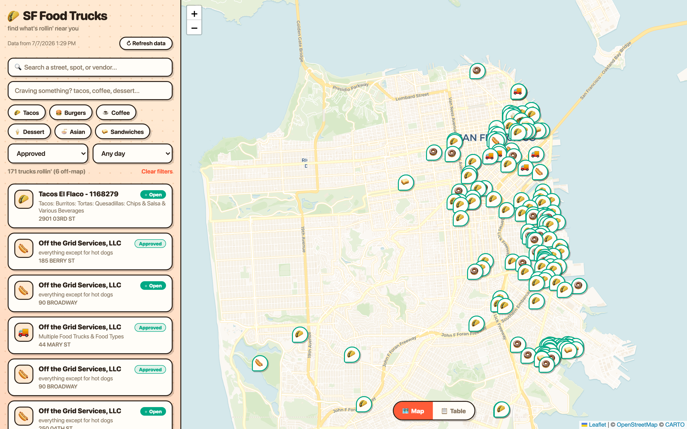
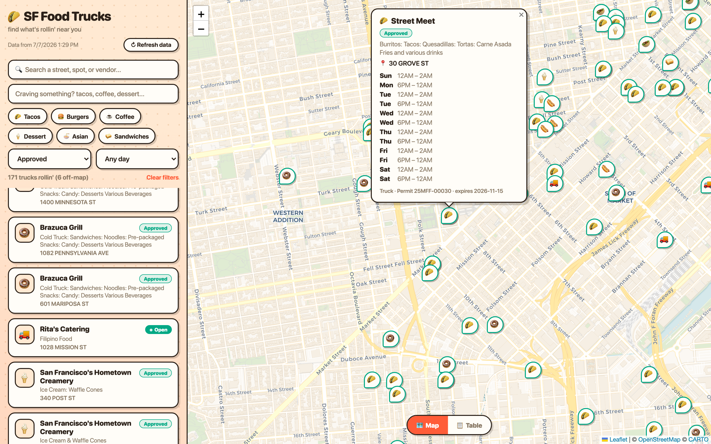
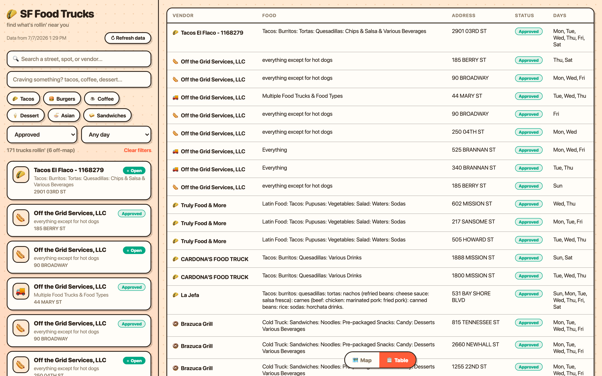
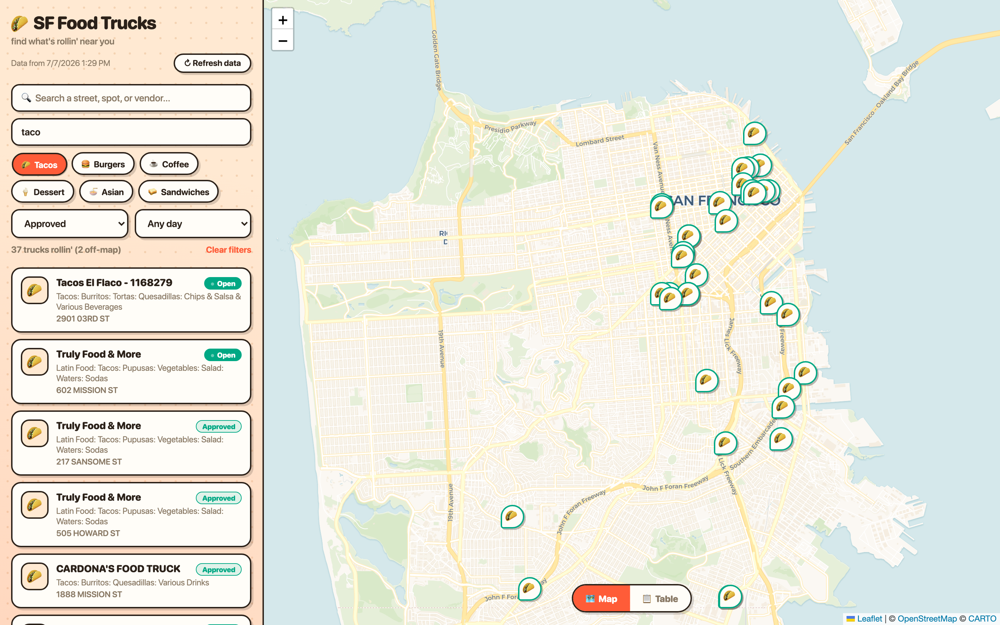
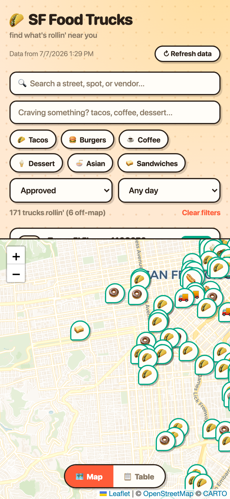

# SF Food Truck Finder

Find San Francisco's permitted mobile food vendors on a map: where they park, what they serve, which days they are there, and whether their permit is current.



## What it does

It pulls the city's mobile food vendor data from DataSF and puts every permitted truck and cart on a Leaflet map. You can search by street or vendor, filter by food type (with quick chips for tacos, coffee, dessert, and more), filter by permit status and by day of week, and check which trucks are open right now against your local time. Each pin opens the vendor's weekly schedule. There is also a table view. After the first load everything is served from a local cache, so the truck data works offline (the map tiles still need a connection).

## Why I built it

SF publishes where food trucks are allowed to operate, but the raw data is spread across two datasets and is awkward to read. I wanted a single map that answers "what is parked near me, and is it actually open," and building it turned out to be a good lesson in not trusting a dataset's field names.

## Data sources

Both are Socrata Open Data API (SODA) datasets. No API key is required; an optional [Socrata app token](https://dev.socrata.com/docs/app-tokens) only raises the rate limit.

| Source | What it provides | API key | Updates |
|---|---|---|---|
| [Mobile Food Facility Permit](https://data.sfgov.org/resource/rqzj-sfat.json) (`rqzj-sfat`) | One row per permitted location: vendor, food items, address, coordinates, permit status, expiration | No | Per DataSF's schedule; the app re-pulls on demand |
| [Mobile Food Schedule](https://data.sfgov.org/resource/jjew-r69b.json) (`jjew-r69b`) | Weekly operating schedule (day and hours) per location | No | Per DataSF's schedule; the app re-pulls on demand |

## The interesting problem

**What I expected.** Two datasets, one for permits and one for schedules, joined on a shared location id, plotted at their coordinates. Straightforward.

**What it actually did.** Two things were wrong. Trucks rendered in the wrong place, some in the ocean or at the null island off the coast of Africa. And trucks vanished the moment I applied a day filter, even trucks I knew operated on that day.

**How I found out.** I stopped trusting the field names and read the raw SODA responses row by row. The location problem was bad coordinates: some permit records carry `0,0` or values well outside San Francisco. The vanishing was subtler. The permit dataset identifies a location with a field called `objectid`, but the schedule dataset refers to the same location with a field called `locationid`. My join was pairing fields by name, so it matched nothing and silently dropped every schedule row. Trucks ended up with empty schedules, and an empty schedule cannot match any day, so the day filter erased them.

**What I decided to do.**

- Join on the identifiers that actually correspond: the schedule's `locationid` against the permit's `objectid` ([app.py](app.py), `_build_trucks`). This is the fix that made schedules and the day filter work.
- Reject coordinates outside a San Francisco bounding box, which drops both `0,0` and the ocean points ([app.py](app.py), `_parse_latlng`).
- Keep trucks that have no valid coordinates in the results anyway. They stay searchable and are flagged "not on map," and the result count shows how many are off-map, rather than hiding permitted vendors.
- Label vendors with no published schedule explicitly in their popup, instead of dropping them for having an empty schedule.

**What I chose not to do.** I did not silently drop trucks with bad coordinates or missing schedules, because that would hide real permitted vendors and make the map look more complete than the data actually is. I did not try to guess or geocode missing coordinates.



## Running it locally

Requires **Python 3.9+**.

```bash
cd FoodTrucks
python3 -m venv .venv
.venv/bin/pip install -r requirements.txt
.venv/bin/python app.py
```

Then open **http://localhost:5757**.

On first load the app fetches both datasets from DataSF and writes a local cache to `data/cache.json`. After that it serves from the cache. Use the **Refresh data** button (or `POST /api/refresh`) to re-pull. Copy `.env.example` if you want to set an optional `SODA_APP_TOKEN`.

## Architecture

- **Frontend** (`static/index.html`, `app.js`, `style.css`) is a single-page app. It loads Leaflet from a CDN, renders the map with CARTO tiles, and does all filtering client-side.
- **Server** (`app.py`) is Flask. On first load or refresh it pages through both SODA datasets, performs the permit-to-schedule join, filters coordinates, and writes the merged result to the cache.
- **Cache** (`data/cache.json`) is the only persistence. It is regenerated on demand and safe to delete. A failed refresh keeps the existing cache.

JSON API:

| Endpoint | Description |
|---|---|
| `GET /api/trucks` | The full merged dataset, `{ fetched_at, trucks: [...] }` |
| `POST /api/refresh` | Re-pull both datasets and rebuild the cache |

## Known limitations

- **The map needs internet, the data does not.** Leaflet and the CARTO map tiles load from CDNs, so offline the list and table still work but the map is blank. Only the truck data is cached locally.
- **Vendors appear once per permitted location.** A single operator like "Off the Grid Services, LLC" shows up many times, one row per location, because that is how the permit dataset is structured. The app does not deduplicate operators.
- **The SF bounding box is a coarse rectangle.** A legitimate truck just outside it would be marked off-map.
- **"Open now" trusts the schedule times.** It compares your local clock against the dataset's `start24`/`end24` and handles overnight shifts, but malformed source times can make it wrong.
- **Filtering is client-side.** Fine for the roughly 500 vendors here, but it would not scale to a much larger dataset without server-side paging.
- **Status defaults to Approved.** Requested, expired, and suspended permits are hidden until you change the status filter.
- **Local and single-user.** It binds to localhost and is not hosted.

## Screenshots

Table view, for scanning vendors, food, addresses, and operating days at a glance:



Filtering to a single food type (the map and list update together):



The layout is responsive:


