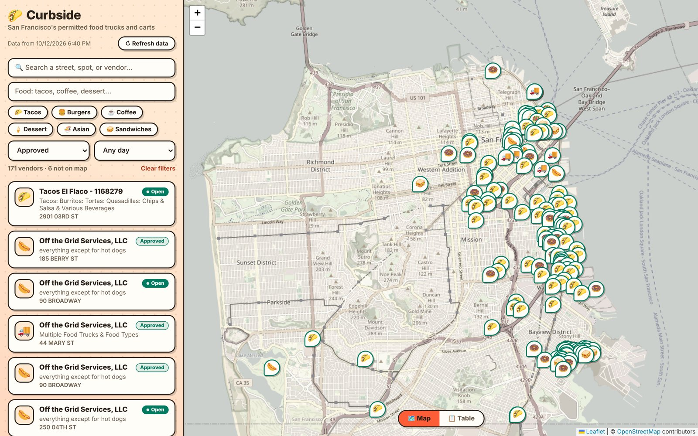
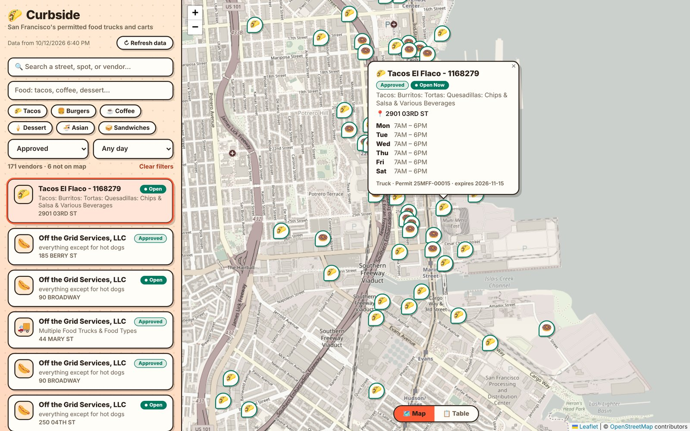

# Curbside

A map of San Francisco's permitted food trucks and carts, built because the city publishes where they may operate but splits it across two datasets that are hard to read on their own.



Search by street or vendor, filter by food, permit status and day, or ask which trucks are scheduled to be open right now. Each pin opens the vendor's weekly schedule; a table view lists the same results.

## How it works

**The join is not on matching field names.** Permits (`rqzj-sfat`) identify a location by `objectid`; schedules (`jjew-r69b`) point at it with `locationid`. Joining by name matched nothing, every truck got an empty schedule, and the day filter hid all of them. The join in `_build_trucks` ([app.py](app.py)) pairs `locationid` with `objectid`.

**Bad coordinates are flagged, not dropped.** Some permits carry `0,0` or points in the ocean. `_parse_latlng` rejects anything outside a San Francisco bounding box, but those vendors stay in the list and table marked "not on map", and the result count says how many. Vendors with no published schedule are labelled as such. Hiding either would make the data look more complete than it is.

**"Open now" runs on San Francisco time.** Schedule times are SF wall-clock times, so the check in [static/schedule.js](static/schedule.js) converts the current moment to `America/Los_Angeles` before comparing, and treats a shift that ends before it starts (9 PM–2 AM) as running past midnight.



## Run it

Requires Python 3.9+.

```bash
python3 -m venv .venv
.venv/bin/pip install -r requirements.txt
.venv/bin/python app.py
```

Open http://localhost:5757. The first page load pulls both datasets from DataSF (a few seconds) and writes `data/cache.json`; after that the app serves from the cache. **Refresh data** (or `POST /api/refresh`) re-pulls, and a failed refresh keeps the old cache. Copy `.env.example` to `.env` to set an optional `SODA_APP_TOKEN`, which only raises DataSF's rate limit.

Tests and lint, as CI runs them:

```bash
.venv/bin/pip install -r requirements-dev.txt
.venv/bin/ruff check . && .venv/bin/pytest -q
node --test "tests/*.test.js"
```

## Data and limits

Both datasets come from [DataSF](https://data.sfgov.org) through the Socrata (SODA) API; no key is required.

| Dataset | Provides |
|---|---|
| [Mobile Food Facility Permit](https://data.sfgov.org/resource/rqzj-sfat.json) | One row per permitted location: vendor, food, address, coordinates, permit status and expiry |
| [Mobile Food Schedule](https://data.sfgov.org/resource/jjew-r69b.json) | Day and hours per location |

- **A permit is not a sighting.** The data says where a vendor is allowed to park and when it has said it operates. It does not say a truck is there today, and "Open now" only means "scheduled now".
- **One row per location, not per operator.** A company with many permitted spots appears many times.
- **The bounding box is a rectangle.** A legitimate spot just outside it would be marked off-map.
- **The map needs the internet; the data does not.** Leaflet and the CARTO tiles load from CDNs. Without them the list and table still work from the cache.
- **Approved permits by default.** Requested, expired and suspended permits are hidden until you change the status filter.
- **Client-side filtering.** Fine for the roughly 500 locations in the dataset, not designed for much more.

## Layout

- `app.py`: Flask server. Pages through both SODA datasets, joins them, filters coordinates and writes the cache. Serves `GET /api/trucks` (`{ fetched_at, trucks }`) and `POST /api/refresh`.
- `static/schedule.js`: schedule and filter logic, with no DOM, so it runs under `node --test`.
- `static/app.js`, `index.html`, `style.css`: the single page. Leaflet from a CDN, no build step.
- `tests/`: pytest for parsing, the join and the API; `node:test` for schedule filtering.

## Status

A personal project. It runs locally and is not hosted, and its data is only as current as your last refresh.
